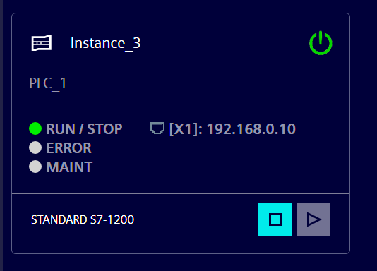
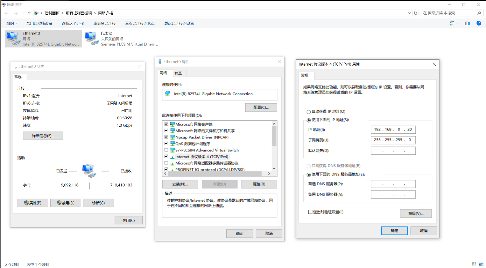

## 1. 实验环境

本文使用以下软件环境完成 PLCSIM 与 EET Basic 的通信：

| 项目 | 环境 |
| --- | --- |
| TIA Portal | V21 |
| PLC 仿真软件 | S7-PLCSIM V21 |
| 外部软件 | EET Basic |
| 操作系统 | Windows 10 虚拟机 |
| 通信工具 | NetToPLCSim |

本文以 S7-PLCSIM V21 标准版为例。PLCSIM Advanced 也可以实现类似的通信，但具体配置方式可能有所不同。

## 2. 通信架构

本文的通信链路如下：

```text
EET Basic
    ↓ S7 通信请求
NetToPLCSim
    ↓ 转发通信
S7-PLCSIM V21
    ↓
TIA Portal V21 中运行的 PLC 程序
```

EET Basic 作为外部客户端运行控制逻辑或测试逻辑，通过 NetToPLCSim 将 S7 通信请求转发给 S7-PLCSIM V21。PLCSIM 中运行的 PLC 程序负责处理输入输出数据，EET Basic 再通过同一条通信链路读取结果或写入新的输入数据。

## 3. PLC 型号选择

在 TIA Portal 中添加新设备时，选择以下 PLC：

| 项目 | 选择 |
| --- | --- |
| 系列 | SIMATIC S7-1200 |
| CPU | CPU 1212C DC/DC/DC |
| 订货号 | 6ES7 212-1AE40-0XB0 |
| 版本 | V4.7 |

本文必须使用 **CPU 1212C DC/DC/DC**，不能改选另外两个型号。该型号没有 Web 服务器，因此后续配置不依赖 Web 服务器功能。

## 4. 设置 PLC 的 IP 地址

在 TIA Portal 中打开 PLC 的设备配置，进入：

```text
PROFINET 接口 [X1] → 以太网地址
```

选择**在项目中设置 IP 地址**，填写以下参数：

| 项目 | 设置 |
| --- | --- |
| IP 地址 | `192.168.0.10` |
| 子网掩码 | `255.255.255.0` |
| 路由器 | 不启用 |

设置完成后，保存项目配置。后续 NetToPLCSim 与 EET Basic 的通信参数需要与该 IP 地址保持一致。

## 5. 启动仿真并下载程序

完成 PLC 配置后，按照以下顺序启动仿真并下载程序：

1. 在 TIA Portal 中点击**启动仿真**；
2. 点击**下载到设备**，将程序下载到 PLCSIM；
3. 下载完成后，点击**转至在线**，确认 TIA Portal 已经连接到仿真 PLC。

启动仿真后，PLCSIM 会显示对应的仿真实例。此时务必确认实例的 PROFINET 接口地址为 `192.168.0.10`，并检查它与 TIA Portal 中设置的 IP 地址一致。



## 6. 配置虚拟机网络

为了让 EET Basic 所在的 Windows 10 虚拟机与 PLCSIM 处于同一个网段，需要为虚拟机网卡设置静态 IPv4 地址。

在 VMware 中将虚拟机网络设置为**桥接模式**，然后打开：

```text
网络与共享中心
→ 更改适配器设置
→ Ethernet0
→ 属性
→ Internet 协议版本 4（TCP/IPv4）
```

选择**使用下面的 IP 地址**，填写：

| 项目 | 设置 |
| --- | --- |
| IP 地址 | `192.168.0.20` |
| 子网掩码 | `255.255.255.0` |
| 默认网关 | 留空 |
| DNS 服务器 | 留空 |

虚拟机的地址 `192.168.0.20` 与 PLCSIM 的地址 `192.168.0.10` 位于同一个 `192.168.0.0/24` 网段中。


